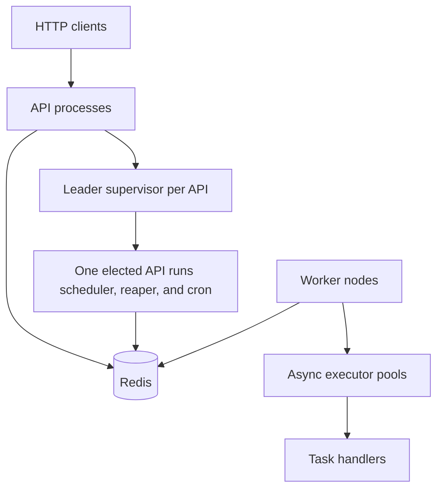
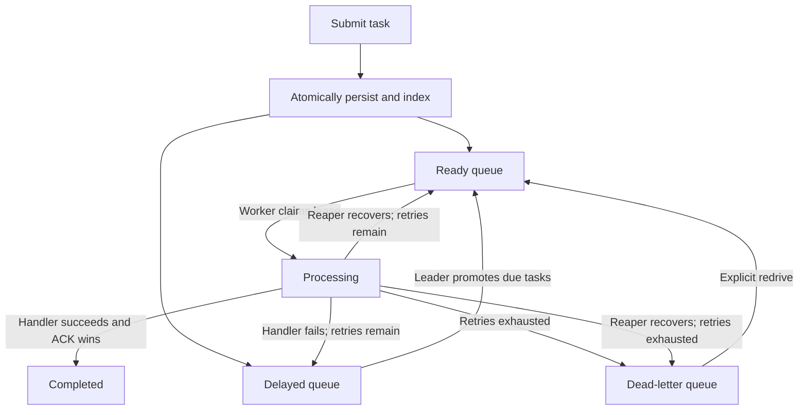

# Architecture

This guide explains how the queue works and the invariants contributors must
preserve. For setup, API examples, and test commands, see the
[development guide](develoment.md). For the product overview, see the
[README](../README.md).

## System overview

The application uses Python 3.14+, FastAPI, asyncio, Redis, and Lua. Redis is the
coordination and persistence store; the current runtime does not require a SQL
database, despite SQL-related packages being present in the dependency list.

### Process responsibilities

| Process | Entrypoint | Responsibilities |
| --- | --- | --- |
| API | `python -m app.main` | Serve HTTP, connect to Redis, build dependencies, and supervise leader-owned background work |
| Worker node | `python -m app.run_worker` | Register the node, heartbeat, claim tasks, run executors, and drain on shutdown |
| Redis | Redis server | Store records and indexes, coordinate leases, and execute atomic transitions |

Every API can serve requests. Only the elected API runs the delayed scheduler,
reaper, and cron materializer. Workers do not compete for API leadership.

### Code boundaries

| Location | Responsibility |
| --- | --- |
| `app/api/` | HTTP routing, schemas, dependencies, and middleware |
| `app/service/` | Application operations, including task submission and cron materialization |
| `app/broker/` | Task claims, processing leases, acknowledgment, and failure routing |
| `app/queue/` | Ready queue, delayed storage, promotion, and wake-up signaling |
| `app/reaper/` | Recovery of dead-node work and expired processing leases |
| `app/store/` | Redis records, indexes, persistence helpers, and storage scripts |
| `app/worker/` | Node lifecycle, async pool, and execution |
| `app/handler/` | Handler registry and built-in workloads |
| `app/model/` | Task, failure, event, node, and cron models |
| `app/core/` | Configuration, logging, and shared leadership context |
| `app/leader.py` | Election and supervision of singleton services |
| `app/container.py` | Shared API dependency wiring |

Keep HTTP handling separate from application operations and Redis transitions.
The worker entrypoint builds its worker dependencies separately from the API
container, preserving independent deployment and lifecycle.

## Task lifecycle

Canonical task statuses are `pending`, `processing`, `completed`, and `failed`.
Ready and delayed tasks both use `pending`; queue indexes distinguish their
scheduling state. Task records contain the handler type, payload, priority,
delay, retry counters, creation time, error, and current owner. Handler results
are described in completion events rather than stored as a separate result field
on the canonical task.

### Submission and idempotency

`TaskService.submit_task()` creates an ID when one is omitted. A supplied ID acts
as the submission idempotency key. `TaskStore.submit()` uses
`app/store/scripts/submit.lua` to perform these operations together:

1. Check the task hash type and reject an existing canonical task without overwriting it.
2. Validate remaining Redis key types, serialized arguments, and the submission counter.
3. Create its task hash and ready or delayed queue membership.
4. Add a capped wake-up token for ready work.
5. Increment the submitted metric and append the submitted event.

A duplicate ordinary submission raises `DuplicateTaskError`, which the API maps
to HTTP 409. Existing tasks are not overwritten or re-enqueued by submission.
Task integer fields cross Lua JSON as strings to avoid double-precision rounding.

Redis scripts execute without interleaving other commands, but a Lua error does
not roll back earlier writes. Submission validates before mutations to reduce
partial-write failures. Its cron mode adds ownership and definition checks and
commits the cursor in the same script.

### Priority, delayed promotion, and the doorbell

Ready tasks are sorted by negative priority: a larger numeric priority produces
a lower score and is claimed first. Equal priorities follow Redis sorted-set
member ordering; this is not a FIFO guarantee.

Delayed tasks are scored by their execution time in Unix seconds. The elected
scheduler scans roughly once per second and promotes batches of up to 100 due
tasks using `app/queue/scripts/promote.lua`. Promotion removes delayed membership,
adds ready membership, and signals waiting workers atomically.

The `taskqueue:ready:signal` list is a bounded doorbell, not the queue itself.
An idle executor blocks with `BLPOP`, then checks the ready sorted set again.
`SIGNAL_BLOCK_MS` bounds the wait, allowing periodic shutdown checks and fallback
pickup even when tokens are consumed by another executor.

### Claiming, execution, and completion

`RedisBroker.dequeue()` uses Lua to remove the highest-priority ready task, insert
its processing deadline, set its owner to the worker node ID, and add it to the
node's owned-task set.

Each worker process runs `WORKER_COUNT` asyncio executor tasks. This controls
concurrency within that process; it does not allocate one CPU core per executor.
The Redis pool reserves additional connections beyond blocked executors so
heartbeats and other operations can proceed.

The executor resolves the handler through the registry and limits execution with
`DRAIN_TIMEOUT_MS`. On success, ACK checks processing membership and node ownership
before removing the lease and setting the task to completed. A lost lease prevents
that worker from updating another node's claim.

Processed metrics and completion events are ancillary updates after ACK. Failures
in those updates are logged without converting a completed task into a failed task.

### Retries, dead letters, and redrive

`max_retries` counts additional attempts after the first execution. Handler failure
is routed by `app/broker/scripts/fail.lua`, which checks the owner and removes the
processing lease as the race guard against ACK, recovery, or another failure call.
It then atomically places the task into delayed or the DLQ.

Normal handler retries wait `min(2 ** retry_number, 60)` seconds, where the first
retry number is 1. Reaper recovery consumes a retry but returns eligible work
directly to ready instead of applying the handler backoff.

A DLQ entry is a serialized `FailedTask`. Use the model's `error`, `owner`,
`failed_at`, and `reason` fields when changing failure persistence.

Redrive drains failed entries, resets task state and retry counters, and re-enqueues
the same IDs. This path currently consists of separate Redis operations; see
[current limits](#current-limits) before changing it or relying on crash recovery
through a redrive.

## Redis data model and units

Task hashes and queue indexes form one logical state. A transition must not leave
a task outside every valid queue after releasing its processing lease.

| Key | Type | Meaning |
| --- | --- | --- |
| `taskqueue:task:{id}` | HASH | Canonical task record |
| `taskqueue:ready` | ZSET | Ready task IDs scored by negative priority |
| `taskqueue:ready:signal` | LIST | Capped worker wake-up tokens |
| `taskqueue:delayed` | ZSET | Task IDs scored by execute-at Unix seconds |
| `taskqueue:processing` | ZSET | Task IDs scored by lease-deadline Unix milliseconds |
| `taskqueue:deadletter` | LIST | Serialized failed tasks |
| `taskqueue:metrics` | HASH | Submission, outcome, retry, and recovery counters |
| `taskqueue:events` | LIST | Bounded recent task events |
| `taskqueue:events:cluster` | LIST | Retained node/recovery lifecycle events |
| `taskqueue:workers` | HASH | Executor status records |
| `taskqueue:nodes` | SET | Known node IDs |
| `taskqueue:node:{id}:hb` | STRING with TTL | Node heartbeat and descriptor |
| `taskqueue:node:{id}:meta` | STRING | Descriptor retained after heartbeat expiry |
| `taskqueue:node:{id}:tasks` | SET | IDs leased by that node |
| `taskqueue:node:{id}:dead` | STRING | First dead-node detection time, Unix milliseconds |
| `taskqueue:leader` | STRING with TTL | API identity and acquisition token |
| `taskqueue:cron:jobs` | SET | Stored cron IDs |
| `taskqueue:cron:job:{id}` | HASH | Definition, revision, eligibility baseline, and cursor |

Configuration durations ending in `_MS` are milliseconds; asyncio sleep and
handler timeouts use seconds. Cron slots and scheduling baselines are Unix
seconds. Leader and heartbeat TTLs passed to Redis use milliseconds.

The application Redis factory currently selects DB 0. Dedicated test URLs can
select other databases; see the development guide for safe fixtures.

Canonical task records and DLQ entries have no automatic expiry or retention
cleanup. Completed records remain stored, and cron definitions persist until
explicitly deleted. Bounded event lists do not imply bounded task storage.

## Worker membership and abandoned work

A node ID combines the hostname and a random suffix. Each executor ID combines
that node ID and an executor index. This distinguishes worker replicas and restarts.

Nodes register metadata and refresh a heartbeat TTL while active. Metadata remains
after the heartbeat expires so the API can display dead nodes with `alive=false`.

A reaper sweep processes dead nodes before expired leases:

1. Find registered nodes whose heartbeat is absent.
2. Write a `SET NX` tombstone to report a death once.
3. Reclaim their owned tasks while the heartbeat remains absent.
4. Prune the descriptor after `DEAD_NODE_GRACE_MS`, once no owned tasks remain.
5. Recover other processing leases whose deadline has passed.

The processing `ZREM` and task-owner comparisons guard competing recovery,
ACK, and failure transitions. A returned heartbeat prevents dead-node recovery
or pruning. Leader ownership checks additionally reject a stale API's writes.

## Leader election and supervision

Every eligible API starts a `LeaderSupervisor`. Workers do not acquire this lease.
A supervisor uses `SET NX PX` to acquire `taskqueue:leader`, storing its process
identity and a new random token for each attempt.

Renewal and follower acquisition attempts use a TTL/3 cadence. Owner-only Lua
scripts compare the complete lease value before extending its expiry or deleting
it. An old tenure cannot renew or release a later acquisition, even when the API
process identity is unchanged.

A `LeaderLease` also has an active flag and a monotonic deadline calculated from
the request's start time. Acquisition, renewal, and release calls have bounded
waits. The local check is repeated after renewal so a late reply cannot revive
expired local ownership.

On successful acquisition, the supervisor starts renewal plus these services:

- Delayed promotion.
- Dead-node and expired-lease recovery.
- Cron materialization.

Renewal rejection, timeout, Redis errors, or local expiry invalidate leadership.
The supervisor cancels and joins its services before attempting owner-only release
and retrying election. Cancellation is cooperative; the Redis scripts also compare
ownership inside each protected queue/recovery/materialization commit.

Unexpected service exits set the supervisor's failure state, are logged, and
propagate. Readiness reports this failure. Ordinary step-down returns to election.
An ineligible API remains available for HTTP without starting singleton services.

`GET /api/leader` reads Redis ownership and reports `is_self=true` only when this
API also has a matching valid local lease. An absent lease returns a null identity.
A healthy follower is not an unhealthy API. If no eligible API owns leadership,
ready tasks can still execute, but promotion, recovery, and cron materialization pause.

A crashed owner leaves its lease until expiry. Takeover waits for the remaining
TTL and a follower attempt; it is not guaranteed at an exact wall-clock deadline.
The acquisition token protects commits on the same authoritative Redis instance;
it is not a monotonic fencing token enforced by external services.

## Cron definitions and materialization

Definitions contain a five-field UTC schedule, task template, enabled state,
creation timestamp, scheduling baseline, success cursor, and internal revision.
`croniter` validates reachable schedules within an eight-year search window.
Standard day-of-month/day-of-week OR semantics apply. Aliases, random/hashed
expressions, seconds fields, and unreachable dates are rejected.

`CronStore` maintains records and the ID index through `app/store/scripts/cron.lua`.
Create uses Redis time for the initial baseline. Enabled-state changes replace the
revision, invalidating snapshots already read by the materializer. Delete/recreate
also produces a fresh revision. Repeating an unchanged enabled state is idempotent.

The materializer obtains one Redis timestamp per scan and, for each enabled job:

1. Finds the latest matching slot at or before that time, including exact boundaries.
2. Skips it unless it is after the creation/resume baseline and success cursor.
3. Builds the task ID as `{cron_id}-{slot_unix}`.
4. Submits through the atomic task script with the expected lease, revision, and cursor.

For an every-minute job last materialized at 10:00, recovery at 10:07:30 submits
only 10:07. Older missed slots are skipped without iterating through all of them.

The submission script rechecks leadership, job existence, enabled state, revision,
baseline, and cursor. It commits the task, ready membership, submitted metric/event,
and cursor together. An existing instance counts as successful materialization
without changing its task state or enqueuing it again. Redis failures leave the
cursor unchanged when nothing committed; a lost successful reply is safe to retry.

Pause/resume retains the success cursor but resets the eligibility baseline to
resume time. Paused occurrences are not replayed. Deletion and pausing do not
cancel already materialized tasks. Cron management works on followers as well as
the leader; only materialization requires leadership.

## Startup, shutdown, and containers

API startup validates settings, checks Redis, builds shared dependencies, and
starts supervision. Its startup event confirms the supervisor coroutine started,
not that this API won election. Shutdown joins supervision and attempts lease
release before closing Redis.

Workers handle SIGINT/SIGTERM by stopping new claims, draining active work while
keeping the heartbeat alive, removing executor state, and deregistering. If drain
fails, the node remains discoverable for recovery. Handler execution is normally
bounded by `DRAIN_TIMEOUT_MS`; Redis cleanup can still delay shutdown.

The Dockerfile uses a shared Python 3.14 slim base, a uv dependency stage, and a
non-root runtime. It copies the virtual environment and all application sources,
including Lua files. Pinned base/tool digests and locked dependencies make inputs
explicit. The build cache is separate from the runtime, and pytest/Ruff are excluded.

Compose runs separate API, worker, and Redis containers on one network. Only the
API is published to host loopback. Application services wait for Redis health and
stop before Redis. A named volume at `/data` persists Redis AOF files, using
`appendfsync everysec`. This can lose roughly the latest second of writes after
an abrupt failure; the volume is not a backup or replicated store.

## Observability

The API exposes task records, executor/node state, recent task/cluster events,
metrics, readiness, and leadership. Cluster events are retained separately so
frequent task activity does not immediately evict node/recovery history.

Events are a bounded operational view, not a durable audit log. The general event
writer uses an inclusive trim bound that can retain 201 main events; submission
trims to 200, and event API reads are capped at 200. Outcome monitoring can lag a
completed Redis transition when ancillary writes fail. `METRICS_PORT` is reserved;
there is no worker HTTP metrics server.

## Current limits

- One authoritative Redis history is assumed. The lease is not consensus across
  divergent Redis masters, and acknowledged writes lost during Redis failover
  are outside the ownership guarantee.
- Task execution can repeat after recovery. Handlers with external side effects
  must supply their own idempotency; submission deduplication is not exactly-once
  handler execution.
- The broker exposes `extend_lease()`, but executors do not periodically call it.
  Its current Lua helper checks processing membership, not node ownership. Keep
  handler timeouts below task visibility timeouts with margin for completion.
- ACK/failure ownership is scoped to node IDs, not a fresh token per task claim.
  Leader acquisition tokens do not change that worker-lease model.
- DLQ redrive pops records and performs save/enqueue as separate operations.
  A failure between them can leave partially redriven work; it does not have the
  atomic guarantees of normal submission or worker failure routing.
- `GET /api/tasks/failed` is registered after `GET /api/tasks/{task_id}` and is
  currently matched as a task lookup for ID `failed`. The intended DLQ listing
  route needs a routing-order fix. The two-segment redrive route is separate.
- Compose is a local setup with no API authentication, TLS termination, Redis
  replication, automatic backups, or deployment orchestration across hosts.
